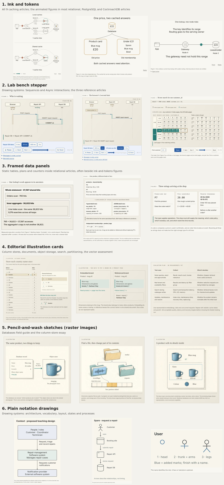
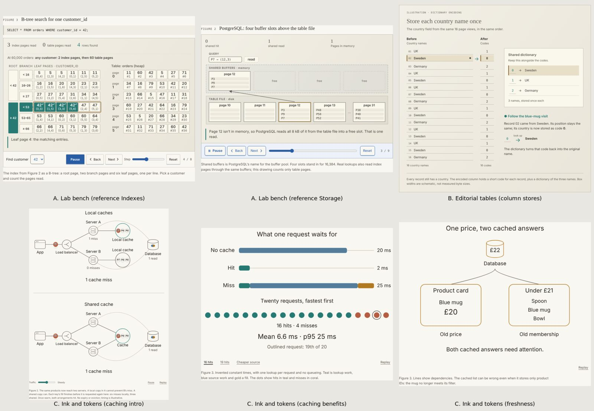
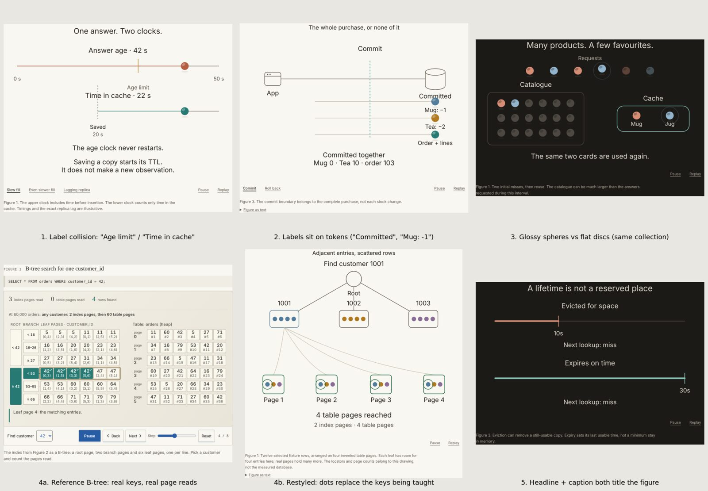

# Skills, process, articles and art style: review and proposal

5 November 2026. Review only: no article, skill or route was changed. This
proposes changes for the owner to decide; nothing here is yet house standard.

## What was examined

- All seven active skills, their five review perspectives and three figure
  references; the archived pre-19 October skills; the 30 October Astra tuning
  record and the prose-independence commission.
- The application-caching commission, coverage tree, briefs, style study and
  visual iteration records.
- Rendered pages from a fresh build, in both themes: nine caching articles, a sample
  of relational articles, the column-store essay and the three reference articles.
  84 figure captures were taken after playback settled.
- Two independent practitioner-level readings of the extracted prose. One covered
  all nine caching articles. The other covered nine relational articles (core,
  PostgreSQL and CockroachDB) and compared them against the reference Indexes and
  Storage articles. The counts quoted below were rechecked directly.

## Summary

1. **The articles are accurate, careful and well ordered, but they land at
   competent-to-proficient, not expert.** Their correctness reasoning is often
   excellent: lease expiry while the owner is still alive, how far commit-then-delete
   gets you, snapshot timing under locking reads. What is missing is the
   practitioner's world: real magnitudes, real output, canonical names, incidents and
   code. The prose also hedges so constantly that strong reasoning reads as junior.
2. **The process causes this more than the writers do.** The skills never say what
   an expert knows, and no planning artefact records it. Every review looks for
   defects, so none checks ambition. The evidence rules make invented numbers plus
   disclaimers the safe route. The concrete taste guidance that existed before
   19 October has gone. Procedure now takes up most of the skill text.
3. **Art style: adopt the caching "ink and tokens" language as the house style.**
   Write it down as a short spec. Add a second register for data-structure internals,
   because the style currently loses the values those lessons depend on. Fix five
   recurring defects.
4. **Proposed process:** give writers an expert dossier and per-article exit
   questions; test each article with a "teach-back" check and a senior-practitioner
   review; restore the house voice; publish provenance once per article. Calibrate
   all of this on one pilot article before changing the whole corpus. Fold seven
   abstract skills into four concrete ones.

## 1. The articles

### Where they are strong

The best passages would hold up against anything published on these subjects:

> Every operation succeeded, yet a new insertion TTL now grants the old answer
> another lifetime. (Freshness and invalidation)

> Cancellation being requested is different from the source confirming it has
> stopped. (Handling cache misses)

> Putting the aggregate after the lock in the SQL text does not give it a new
> statement snapshot. (Locks and deadlocks)

The versioned-fills token protocol and its counterexample lab are both strong. So is
the replication drill that shows a synced receive position of `0/40013A8` while
replay stays at `0/4000000`. Ordering is good, terms are introduced where they are
needed, and the running example stays consistent.

### Why they do not reach expert level

| Symptom | Evidence |
| --- | --- |
| Few real numbers | Reference Storage: 40 numbers with units in 8,300 words. Current Storage and durability: 3 in 3,000. Failover: 1. Caching timings are invented throughout (1–2 ms lookups, 20 ms builds), which gives the wrong sense of where break-even lies. |
| Defensive negation | References: 0–1 "is not / does not / cannot" per 1,000 words. Current articles: 8–9, and up to 23 in some relational pieces. Across the corpus, "is not a" appears 97 times and "does not establish" 72 times. |
| Disclaimers on everything | About 38 "illustrative/invented" notes across nine caching articles. The references gather provenance into one closing "Where the numbers come from" section. |
| Ritual recaps | 41 relational articles restate order 103's pending state and £29.00 total. 7 of 9 caching articles repeat that checkout reads the authoritative source. |
| Deferral | About 32 "X develops / owns that" hand-offs in caching alone. Sections often end by sending the substance elsewhere. |
| Little real output or code | Only one relational article shows actual `EXPLAIN`, log or `ERROR:` text. Handling cache misses describes singleflight, admission and early refresh without a line of code. |
| Canonical names absent | Caching never mentions thundering herd, XFetch or probabilistic early expiry, stale-while-revalidate, Redis client-side caching, hot-key splitting, MGET fan-out and tail latency, big keys or `UNLINK`, metastable failure, Facebook's gutter pool, or Zipf and miss-ratio curves. Relational lacks the DDL lock-queue pile-up, the XID horizon, per-connection process cost, CockroachDB's 40001 retry reasons and contention views. |
| Toy scale | One mug, three orders, invented page addresses. A reader never meets a realistically sized system, so they cannot recognise their own. |

Both independent readers made the same recommendation without seeing each other's
work. Teach from observed artefacts on a realistically sized system. State real
magnitudes plainly. Name the standard patterns and incidents. Move provenance into
one closing section. The reasoning is already there; what is missing is the
practitioner texture around it.

Omitting some subjects is fine: ARC, SIEVE, CDN and HTTP caching, InnoDB or SQL
Server breadth, and Raft or Parallel Commits proofs.

## 2. Why the process produces this level

1. **The target is never made operational.** "Intelligent newcomer to expert
   practitioner" appears in every skill, but nothing says what an expert in *this*
   subject knows, measures, names or has seen go wrong. The archived planning skill
   did ask: "What can an expert do, and what does each ability need?" The current
   breakdown asks for decisions and failure cases, but its output is a heading tree.
   The research never becomes an artefact a writer or reviewer can check against.
2. **The brief caps the depth.** The practitioner perspective checks "coverage of
   the brief's decisions". A thin brief produces a thin article that passes review.
   The caching briefs are mostly decisions and drawing directions ("Draw the repeated
   source reads"). None names a paper, pattern, magnitude, tool or incident.
3. **Every review looks for defects; none looks for ambition.** Reviewers report
   stalls, unsupported claims and figure dependence. None asks "what would the best
   article on the internet about this contain that ours lacks?" or "would a staff
   engineer learn something?" Repairs therefore add caveats rather than substance,
   and each review round makes the prose more cautious.
4. **The evidence rules make realism expensive and hedging cheap.** "Distinguish
   illustrative models from observed execution" is right. In practice it pushed
   writers to invent numbers and disclaim them locally, rather than cite real
   figures once. The archived style guide said "Numbers are exact and systems are
   real", and that sentence was lost in the 19 October rewrite.
5. **Your taste was removed from the skills.** The archived style skill named the
   anchors: Sam Who's animated explanations, Ciechanowski's development (but not his
   introductions), no Julia Evans tone, no Grigorik-length sentences. It also set
   the structure: watch the behaviour, then name it; simple version fails, fix, the
   fix's cost. The current skills only say "study the three references". Those
   references are in a visual style you have since moved away from, yet the figures
   skill still points writers to them for visual craft.
6. **Procedure crowds out craft.** By my reading, more than half the ~3,800 words of
   active skill text govern scheduling, evidence reuse, confirmations and handoffs.
   Very few describe what the finished article contains. The skill text is also
   written in the compressed, abstract register the editorial perspective forbids
   ("Retain unaffected checks; do not add routine final readings or restart review
   for optional polish"). The 30 October pass tuned instruction-following
   boundaries, not quality. The records have grown to about 2.8 million words across
   `docs/article-work/`, 527 MB with screenshots. That is a large commit-history cost
   and a temptation for agents to read history.
7. **Prose independence has a cost worth managing.** The rule is right and stays.
   But it now leads writers to transcribe each figure into prose, and to plan figures
   late as "optional reinforcement". The better framing: the prose owns the argument
   and the facts; a figure exists to make something *felt* that prose can only state,
   such as timing, accumulation, contention or scale. Plan it for that from the
   outline.
8. **The dense-prose check pushes towards uniform short sentences.** Its thresholds
   (45-word sentences, 90-word paragraphs) are reasonable. But combined with review
   pressure, sentences have shrunk to 15–20 words against 27–28 in the references,
   in a monotone declarative-then-qualification rhythm. Keep the check as a pointer,
   and say in the skill that rhythm should vary.

## 3. Art style

### Styles in use today

A survey of every built page with figures found six styles, not three:

1. **Ink and tokens:** every caching article, and the animated figures in most
   relational, PostgreSQL and CockroachDB articles.
2. **Lab bench stepper:** Drawing systems' Sequences and Async interactions, and the
   three reference articles.
3. **Framed data panels:** static tables, plans and counters inside relational
   articles, often on the same page as ink-and-tokens figures.
4. **Editorial illustration cards:** column stores, documents, object storage,
   search, partitioning and the vector assessment.
5. **Pencil-and-wash sketches:** raster images in the databases field guide and the
   column-store essay.
6. **Plain notation drawings:** Drawing systems' architecture, vocabulary, layout,
   states and processes. These teach diagram notation, so their plainness is
   deliberate.

The comparison below concentrates on the three styles that carry mechanism.

| | A. Lab bench (references) | B. Editorial tables (column stores) | C. Ink and tokens (caching) |
| --- | --- | --- | --- |
| Look | Framed beige panel, monospace data, full stepper bar | Quiet tables, serif titles, paper | Open canvas, fine ink, role icons, coloured tokens, self-playing motion |
| Strength | Real values; you can count pages and keys | Calm, precise, good for comparisons | Watchable, calm in both themes, closest to the Sam Who feel, already a shared library (`relational-motion/drawing.mjs`) |
| Weakness | Heavy chrome; feels like an app; controls dominate | Static; little sense of mechanism over time | Loses real values when applied to internals; some craft defects |

**Recommendation: make C the house style**, as you suggested. It has the strongest
identity, it already spans two collections, and it fits motion-led teaching. It
needs two changes to work across every subject:

1. **A data register inside the same language.** For internals (B-tree pages,
   buffers, WAL records, byte layouts), use the same ink, palette and type, but with
   cells carrying real values, unframed and laid out like B's tables. Pair 4a and 4b
   below show the problem: the restyled index figure replaced the keys being taught
   with coloured dots. Rule: if the reader should be able to read a value, draw the
   value.
2. **A written spec** (below), so that each new figure stops reinventing the details.

Defects to fix wherever they occur:

1. **Label collisions.** "Age limit" collides with "Time in cache" (Freshness,
   Figure 1). "Root" is crossed by a line (Indexes, Figure 1).
2. **Labels on tokens.** "Committed" and "Mug: −1" sit on the balls (relational
   introduction, Figure 3).
3. **Two token treatments.** Glossy spheres with a highlight and shadow sit beside
   flat discs, sometimes in the same article.
4. **Lost values.** See the data register above.
5. **Double titling.** A large in-figure headline ("A lifetime is not a reserved
   place") sits above a caption that titles the figure again. Mixed control placement
   adds to it: dropdowns at the top in one figure, text tabs at the bottom in others.
   A few framed lab-bench figures also remain inside restyled articles.

### Draft spec: ink and tokens

- **Canvas:** no frame or panel; the page's own paper; generous space. Desktop and
  phone layouts are drawn separately, never scaled.
- **Ink:** 1.6 px strokes in secondary text colour. Each role (browser/app, server,
  cache ring, database cylinder, load balancer, worker, queue) has one icon used
  site-wide, from `drawing.mjs`.
- **Colour has two jobs only.** Identity colours (coral, blue, gold, purple) track
  *which thing* (a request, product or customer). Teal means the cache, the accepted
  path, or the useful outcome. Never use colour for decoration.
- **Tokens:** one treatment site-wide. I recommend flat discs, because the glossy
  spheres read as toys beside fine ink. This is your call: the spheres came from
  your "bounce" request.
- **Type:** the site sans, labels about 21–23 units, values a step larger. Only one
  title: either a short in-figure statement of the takeaway, or the caption, not
  both. Provenance ("timings are illustrative") goes in the article's numbers
  section, not every caption.
- **Motion:** plays once when visible and settles to a final frame that holds the
  whole lesson. Movement shows cause, such as a request travelling, a fill
  arriving or a slot held. Use the step-through stepper only when the reader needs
  to count states.
- **Controls:** Pause/Replay as text links at the bottom right; variants as
  underlined text tabs at the bottom left; nothing at the top.
- **Mechanical checks to add:** a sampled-frame label-collision check (text bounding
  boxes against each other and against tokens and lines); a lint for gradients or
  filters on tokens; a one-title check.

## 4. Proposed process

The aim is to make "expert" something a writer can aim at and a reviewer can test,
and to put craft back into the skills.

### New artefacts

**Expert dossier (one per collection, before the tree).** A researched inventory of:

- the vocabulary practitioners search for and use in design reviews;
- canonical sources (papers, books, standard posts);
- real magnitudes and defaults;
- the tools and commands used daily, with what their output looks like;
- named failure patterns and public incidents;
- common newcomer misconceptions;
- what an expert does that a competent engineer does not.

Each item gets an owner article or an explicit "omitted because". The coverage tree
is derived from the dossier, not the other way round.

**Exit questions (6–10 per article, from the dossier).** These replace the prose
brief as the writer's contract. At least half should be hard: estimate a magnitude,
diagnose from output, defend a design, write the short piece of code. For example,
for Handling cache misses:

- A product page fetches 40 cards with sequential GETs at 0.3 ms p99 each.
  What is the page's cache-time p99, and what would you change?
- One cache shard holding an eighth of the keys fails at 20k req/s and a 95% hit
  ratio. How many extra source reads arrive each second, and what stops them
  reaching the database?
- Why does a lease's lifetime not bound the source work it permits, and what do you
  add?
- Name the standard algorithm for spreading refreshes before expiry, and say when
  fixed jitter is enough.
- Write a per-key in-flight wrapper with per-caller deadlines (about 15 lines).

**One exemplar at the target level.** Choose one article, probably Handling cache
misses because its reasoning is already strong, and raise it together with you to
the target. Add real magnitudes, canonical names, code, one incident and one
provenance section, with figures in the finished spec. It then becomes the first
reference for both prose and visuals, alongside or instead of the three older ones.
Tune the skills against it before touching the rest of the corpus.

### Changed reviews

- **Teach-back check.** A fresh agent receives only the rendered article and answers
  the exit questions, quoting the passage that supports each answer. A second agent
  marks the answers. An unsupported or wrong answer is a finding against the
  article. Quoting is required because models otherwise answer from what they
  already know. This is the cheapest test of level we can automate.
- **Senior-practitioner review (replaces practitioner and value).** "What would you
  add, cut or rename? Compare it with the best existing piece on the subject. Would
  you send this to a new hire instead?" Accuracy checking against primary sources
  remains.
- **Reader-and-visual review (merges teaching, editorial and visual)**, using the
  written voice and visual spec rather than only the references.
- Keep the prose-independence test and blind first readings.

### Writing guidance to restore or add

- Restore the taste anchors and the structure: watch, then name; a simple version
  fails, then the fix, then the fix's cost; exact numbers and real systems; plain
  verdicts.
- Use real numbers first. Use invented numbers only when the point is the
  arithmetic, and say so once, in a closing "Where the numbers come from" section.
- Keep negation for contrasts that prevent a mistake, and state what a thing *is*.
  Mention the running example's background facts only where they change the lesson.
- Make the running example realistic in scale. Keep the shop, but give it about
  2 million products, peak request rates, 30 app instances and a three-shard cache,
  so that magnitudes are honest. The existing native labs can produce real output
  to show.
- Show short code at decision points and real output where a practitioner would
  look at output.
- Let rhythm vary; the dense-prose check points at sentences to reread, and does
  not set a target length.

### Lighter structure

| Now | Proposed |
| --- | --- |
| orchestrate, breakdown | **plan**: dossier, tree, exit questions |
| write, figures, continuity | **write**: voice, numbers policy, figure spec, continuity pass |
| review, revise | **review**: teach-back, senior practitioner, reader-and-visual, plus repair and confirmation |
| (orchestration rules spread throughout) | **orchestrate**: one page on who does what, when to stop, and publication |

Write each skill in plain, concrete language, with good/bad pairs taken from our
own articles. Keep one README per commission with a findings table. Keep only the
evidence that supports a claim in an article, and move screenshots out of git or
prune them.

## 5. Decisions for the owner

| Question | Status, 5 November |
| --- | --- |
| 1. Art style: ink and tokens plus the data register? Flat discs or glossy spheres? | Decided: ink and tokens, as rendered in Study A of the [style lab](style-lab.html), with flat discs. Recorded in [Figure style: ink and tokens](../../figure-style.md). |
| 2. Pilot: raise Handling cache misses as the exemplar | Agreed. |
| 3. Numbers policy: real first, one provenance section per article | Open. The owner asked where real numbers would help; see below. |
| 4. Restructure the skills into four | Done on 5 November, at the owner's request, before the pilot. OpenAI's [Rethinking skills and prompts for GPT-6 Astra](https://developers.openai.com/blog/rethinking-skills-and-prompts-for-gpt-6-astra) was read first; see [Skills update](#skills-update-5-november) below. The pilot will calibrate the new skills. |

### Where real numbers would help

A real number earns its place when the reader's decision depends on magnitude.
Invented numbers remain right when the lesson is ordering or arithmetic. In the
stampede example, for instance, the 0, 20, 40 and 60 ms arrivals only establish
who starts a read before the first fill finishes.

Three measurements show the difference. They were taken on 5 November 2026 with
Redis 7.0.15 over loopback in a 4-vCPU container, using
[`redis-measure.py`](redis-measure.py) and `redis-benchmark`. A network hop adds
its round trip to every request. The pilot would remeasure on the lab's Redis 8
setup and record its conditions.

| Measurement | Result | Decision it informs |
| --- | --- | --- |
| Memory for 100,000 cards with 500-byte values and 30-byte keys | 59 MiB: 619 bytes per entry, 119 above the value | The shop's whole catalogue of about 2 million cards needs about 1.2 GiB. That decides whether "cache everything" is cheap or whether eviction matters, which the memory article currently argues through an 18-step trace in abstract units. |
| 40 product cards for a listing page | 40 sequential GETs: median 1.6 ms, p99 2.2 ms. One MGET: median 0.09 ms. | Per-request round trips dominate. Over a 0.3 ms network hop, sequential lookups cost about 12 ms before any work. Batching is a first-order design choice that the collection never mentions. |
| GET throughput with 500-byte values | About 86,000 per second with 50 clients; about 25,600 per second from one client | Set this beside the database's tested capacity, and a cold or failed cache shows whether the source can survive the full miss load or needs admission control. That turns "the source may be overloaded" into a calculation the reader can do for their own system. |

The reference Storage article shows the same effect. "5.1 ms a commit is 196
commits a second. Sixteen clients get eight times the throughput" teaches group
commit through a number the reader can check against their own disks.

## Skills update, 5 November

The seven skills became four: `staycurrent-plan`, `staycurrent-write`,
`staycurrent-review` and `staycurrent-orchestrate`. The previous suite, with its
`AGENTS.md` and `CLAUDE.md`, is archived in
[`docs/history/skills-before-2026-11-05/`](../../history/skills-before-2026-11-05/).

| Article guidance | What changed here |
| --- | --- |
| Short descriptions that say exactly when to use a skill | Each description names the task and its "use when". Orchestrate now applies only to multi-article commissions. |
| Root skill file as a minimal router, with supporting docs loaded when relevant | The dossier, tree and exit-question guides sit under plan. Voice, figures, stepper and database verification sit under write. The three lenses sit under review, and an assigned lens loads only its own file. |
| Drop elaborate itineraries and recipes | The procedural rules on scheduling, evidence reuse and handoffs were cut to what decides quality and completion. |
| Contextual pointers instead of blanket reading | `AGENTS.md` and `CLAUDE.md` point to documents by situation. Writers read the one reference article closest in shape to their subject, not all three every time. |
| Drop redundant verification prompts | Generic "check your work" language was removed. The checks that remain are specific to this publication: the teach-back check, prose without figures, dense-prose and the figure defect list. |
| Give permission for safe workflows; avoid needless stop-for-review gates | Builds, previews and disposable databases may be run, fixed and rerun without asking. Orchestrate carries work through to its definition of done, and stops early only where the commission says so or for owner decisions. |
| Define "done" up front | Each skill ends with an explicit done list. |
| Consider every model that reads repository skills | The skills stay in `.agents/skills/` for Codex, symlinked from `.claude/skills/` for Claude, in plain language without model-specific tricks. |

The content changes follow this review. They add an expert dossier, exit questions,
a teach-back lens and a senior-practitioner lens that compares the article with the
best existing explanation. They restore the voice anchors and structure removed on
19 October, add a numbers policy (real figures where a decision depends on magnitude,
provenance stated once) and point figures at `docs/figure-style.md`. Prose independence,
primary-source checking, fresh agents for every assignment, blind first reader reviews
and the publication boundary are unchanged.

The numbers policy encodes this review's recommendation. The owner had not yet
confirmed it when the skills were updated.

### Dry run and fixes

A fresh agent traced eight realistic requests through the new skills before use:

- planning a new collection;
- writing a standalone article;
- a targeted repair;
- a single teach-back assignment;
- a collection review;
- site maintenance;
- publication;
- an unreviewed draft.

It found these gaps, all fixed the same day:

- **Drafts.** "Draft route" was undefined. `AGENTS.md` now says unpublished content stays
  off `main`, on a branch or behind a draft-preview flag.
- **Standalone articles.** The route for one article was unclear. It is now: a short plan,
  then write, then the three lenses.
- **Teach-back.** The lens conflicted with "agents do not commission others". It now
  allows its two-step hand-off.
- **Missing exit questions.** Articles written before November have none. They are now
  written first.
- **Plan done list.** The plan skill gained one.
- **Collection reviews.** The reader lens gained collection checks.
- **Terms.** "Coordinator" and the reviewed version are now defined.
- **Repairs.** A targeted repair no longer pulls in figure restyling.
- **Delivery.** Maintenance push permission and the publication steps now live in
  `AGENTS.md`.
- **Repair rounds.** Repeated teach-back failures now go to the coordinator to decide.
- **Reference reading.** Writers read a reference article in full only when starting a
  collection.

The dry run also suggested reducing `CLAUDE.md` to an include of `AGENTS.md` so the two
cannot drift. That changes the owner's Claude configuration, so it is left as a
suggestion.
