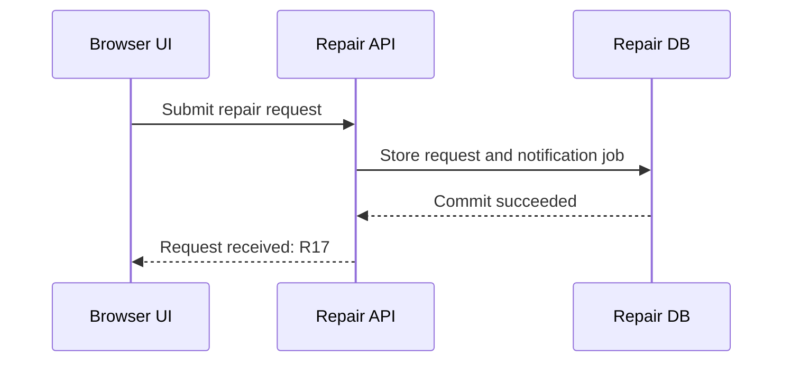
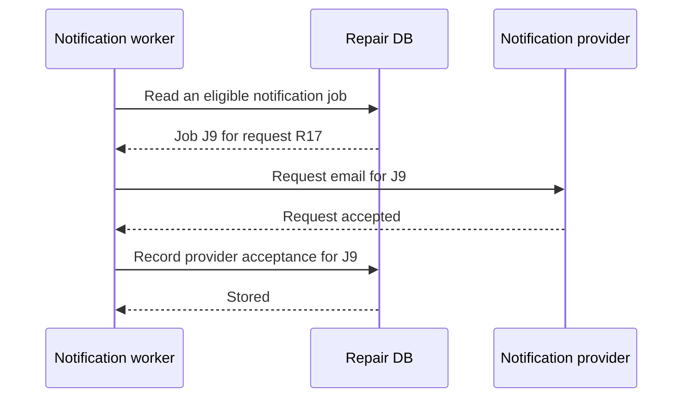
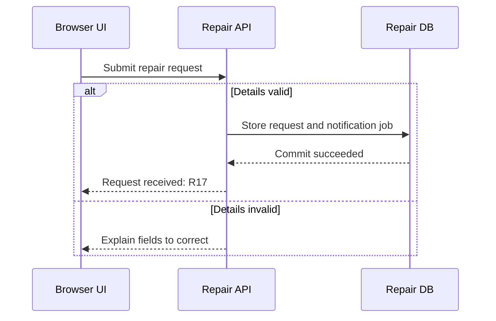
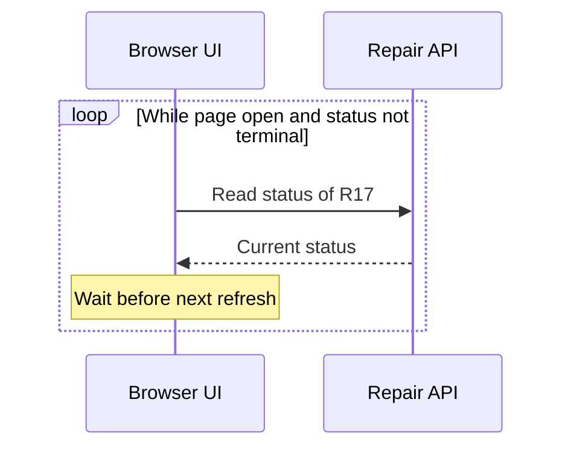
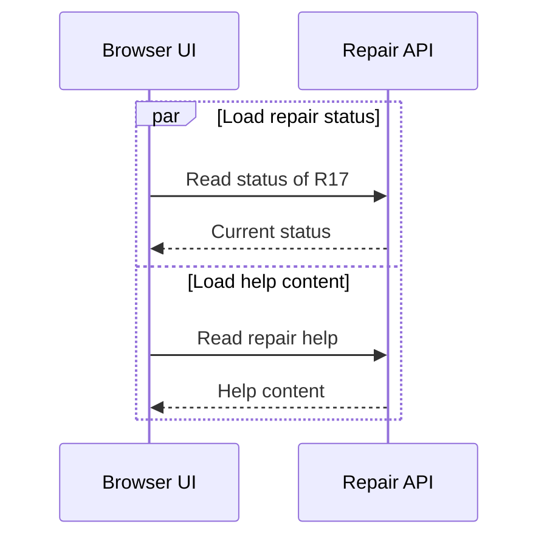

A sequence diagram follows an interaction between participants. Each participant has a vertical line, called a **lifeline**. Messages cross between those lines, with later events drawn lower down. This lets us ask who sends a request, who can answer it, and what the sender knows when a reply arrives—or fails to arrive.

The drawing is especially useful when a box-and-arrow architecture view leaves behaviour ambiguous. An arrow from a browser to an API tells us that they communicate. A sequence can show the browser submitting a repair request, the API storing it, and the browser receiving a receipt before any notification is attempted.

We will use an invented repair service with a browser UI, a Repair API and a Repair DB. The API stores repair requests and notification jobs. A separate notification worker reads jobs from the database and calls an external notification provider. The database is the store here; the design does not contain a separate message broker.

The examples use Mermaid, a text language that renders diagrams. Each code block is complete and can be pasted into a Mermaid-capable editor. The hand-arranged figures beside them preserve the messages while keeping the panels small. They are explanatory drawings, not screenshots of one particular Mermaid layout. The [Mermaid sequence reference](https://mermaid.js.org/syntax/sequenceDiagram.html) documents the syntax and arrow forms.

## Follow one request before adding alternatives

Choose the start and end of the interaction. Here we begin when the browser submits a repair request and stop when it receives the request ID. We assume the input is accepted and the database write succeeds. Naming this case keeps a small successful trace from pretending to describe every outcome.

Declare participants in a useful left-to-right order. Short identifiers keep the source readable; `as` supplies the labels readers see. The database belongs on the diagram because its reply determines when the API can report that the request is stored.

<figure><figcaption>Read down the lifelines. The receipt follows the successful store. Email delivery is outside this interaction.</figcaption></figure>

The solid filled-arrow messages are calls in this example; dashed arrows are replies. Put the operation or result on the line. “Data” would conceal whether the database is being asked to read, write or acknowledge something. “Request received: R17” says what the browser learns without claiming that a technician has accepted the job.

The store message abbreviates an intended transaction that writes the request and its notification job together. The diagram records that design choice; it does not execute a transaction or prove the implementation uses one. If a review depends on that boundary, check the code or describe the transaction in a linked implementation note.

Vertical distance is not elapsed time. The long space before a reply might exist just to fit its label. Add an explicit duration or use a measured timeline when investigating latency. Similarly, participant placement is for reading: the API drawn between browser and database need not be physically between them on a network.

## Draw the worker's interaction separately

The receipt does not wait for the notification provider. Later, the worker reads an eligible job and asks the provider to send a message. This second panel starts with a job available in Repair DB. It omits how workers claim jobs and avoid conflicting work; those would be separate implementation questions.

<figure><figcaption>The worker initiates the database read. Provider acceptance is recorded; this trace contains no evidence that the customer opened or received an email.</figcaption></figure>

Notice how several facts disappeared when we split the pictures. The first panel does not say how quickly the worker will run. The second starts after the job exists. Together they explain the intended relationship, but they do not supply a bound on delivery time.

Asynchronous work does not require drawing every call with an asynchronous arrow. The worker runs independently of the browser's request, yet it can still make an ordinary request and wait for the provider's answer. Mermaid's `-)` arrow can mark a one-way asynchronous message when that is what the interaction means. Choose the form from the message's behaviour, not from the fact that a worker exists.

Activation bars are optional narrow rectangles along lifelines. They can show the interval during which a participant is handling a call. In Mermaid, `activate API` and `deactivate API` delimit one explicitly. Explain what the bars mean in your drawing; they do not measure CPU use, and omitting them often makes an introductory trace easier to read.

## Alternatives describe different paths

Now change the request. Before it writes anything, the API validates the submitted details. A successful validation continues to the store. Invalid details produce a correction response. Mermaid's `alt`, `else` and `end` enclose alternative paths.

<figure><figcaption>The browser receives one of these outcomes for this attempt. The lower section is an alternative, not another reply after success.</figcaption></figure>

The condition belongs to the point where someone can evaluate it. The API knows whether these details passed its validation. A condition such as “The email will arrive” would need information the API does not have here.

Keep alternate paths at a useful scale. A deeply nested diagram containing every validation field, storage failure and notification response is hard to trace. Give the significant choice its own panel, then name the omitted cases. A brief `opt` block is useful when an interaction may occur but there is no second branch worth showing—for example, fetching extra diagnostic details only when the user expands them.

## A missing reply leaves more than one possible history

Suppose the worker calls the provider and times out. It knows that no reply arrived before its deadline. It does not yet know whether the provider accepted the request. Two possible histories fit that observation: the request never reached the provider, or the provider accepted it and the response was lost.

<figure><figcaption>“No reply” describes the worker's evidence. It does not identify which provider history occurred.</figcaption></figure>

A retry adds another request to the trace. It does not remove the first request from history. If both attempts are accepted, could they cause two emails? Does the provider offer a deduplication key? If so, what is its scope and retention period? Those answers require a provider contract and implementation evidence. We have deliberately left them unresolved in this invented system.

When drawing the uncertainty, put a note on the worker's lifeline: “Timed out; outcome unknown”. Avoid a return arrow labelled “Failed” unless a participant actually sent a failure response. An absent message cannot carry an error code. A crossed message arrow can illustrate a lost message in an explicitly chosen scenario, but it does not reveal that this was the scenario the worker experienced.

For a review, draw the two histories separately before proposing retry behaviour. The purpose is to discover what the caller must distinguish. A neat retry loop is not evidence of exactly-once delivery.

## Repetition and independent work

A loop frame shows repeated interactions. Give it a meaningful continuation condition and an exit. Here the browser refreshes the repair status until it becomes terminal or the user leaves the page. This is a proposed polling behaviour used to demonstrate the notation, not an established feature of the repair service.

<figure><figcaption>The condition and wait are part of the behaviour. The frame alone does not supply a refresh interval or an upper request rate.</figcaption></figure>

Write what “terminal” means for this view: for example, cancelled or completed. If a waiting-for-approval status still needs updates, it is not terminal for this loop. The API's internal database read is omitted because this panel's question is the browser's repetition.

Use `par` for branches that may proceed independently. Consider an explicit UI variation: after receiving R17, the browser loads the status and available help content without requiring either response first.

<figure><figcaption>Each branch retains its own request-before-reply order. Their placement in the drawing does not require the status reply to precede the help request.</figcaption></figure>

The frame permits interleaving; it does not guarantee simultaneous execution or that the API uses two threads. If the UI needs both results before enabling an action, state that dependency after the frame. If one branch must use a value returned by the other, they are not independent at that point and should be drawn in order.

## Check what the picture actually claims

Read every message from its sender's point of view. Does that participant know the data on the label yet? Then read each response from its recipient's point of view. What new fact can the recipient now rely on? This catches a common error: putting the outcome the author hopes for on a reply that can only acknowledge acceptance.

Run the Mermaid source through a renderer, then inspect the figure. Parsing catches syntax errors; it cannot tell whether the database reply belongs before the browser receipt. Keep the executable source beside the explanation so a later editor can change the scenario and compare the result. Pin the renderer version in a maintained project when visual stability matters.

For practice, draw a photo upload with two participants, a phone and an upload API. The API returns an upload ID, but image processing happens later. First draw the successful submission. Then draw the case where the reply is lost. What can the phone safely tell the user?

A useful successful trace labels the reply “Upload received: U4”, reserving “Image ready” for evidence of completed processing. In the lost-reply case, the phone knows only that it lacks an answer. A second upload may duplicate the first unless the contract provides a way to identify or reconcile attempts. Draw that unanswered question beside the retry rather than silently assuming it away.

Continue with [Drawing at the whiteboard](/learn/drawing-systems/whiteboarding/) to construct and revise these views during a conversation, or [Keeping diagrams useful](/learn/drawing-systems/maintaining/) to preserve their source and assumptions for the next review.
